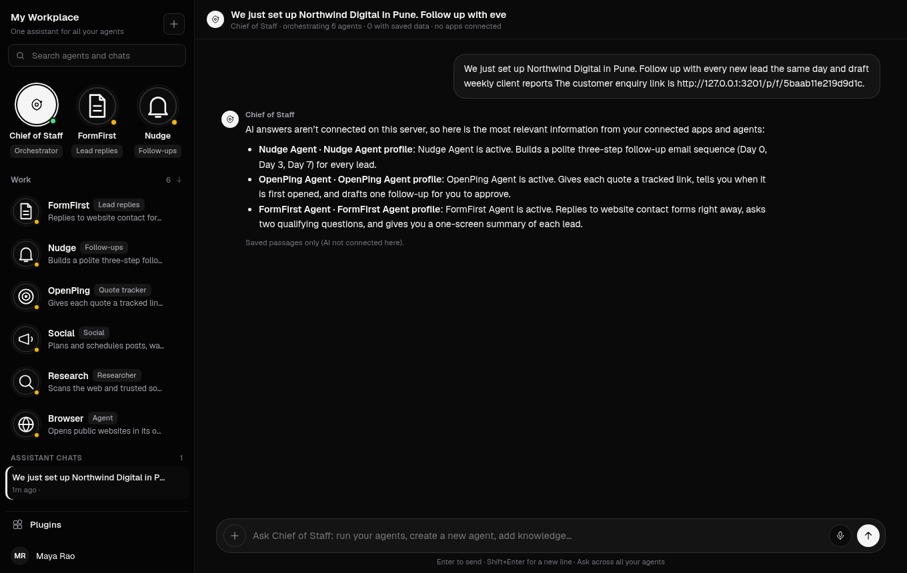
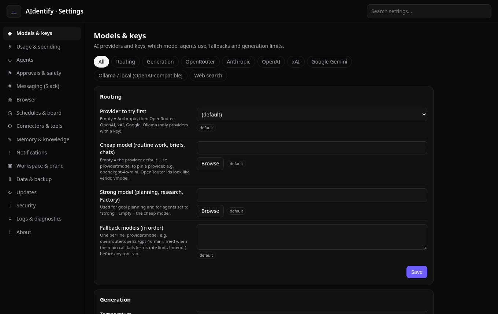
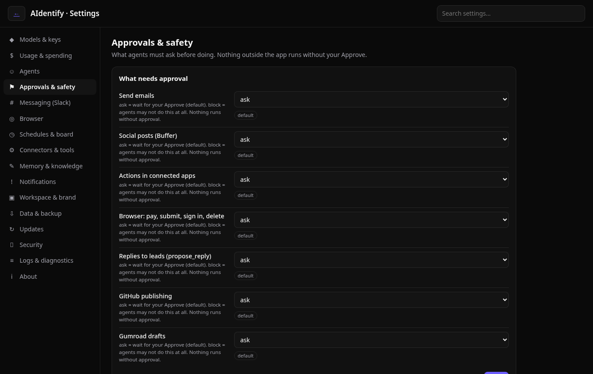

# AaaS handoff

## Chief inbound wire (30 Oct 2026, IST) — branch `parallel/chief-inbound-wire` (stacks on PR #16)
- `runRouted` in `lib/freech.js` calls `routeChiefInbound` for owner messages (WA QR, Telegram, Slack). Send intents → pending approval only; nothing sends without approval. Mock-only tests in `test/v271-chief-wire.test.mjs`.
## BYOK clarity (30 Oct 2026, IST) — `parallel/byok-clarity`
Copy only: owners bring their own AI key; the server key is a capped demo fallback, never the goal (brief P0-7). No platform-paid key path. Test: `test/byok-copy.test.mjs`.

## Clinic team (AaaS v2) — branch `cursor/aaas-v2-dental-dashboard-2181`

Local demo: `npm start`, then http://localhost:3000/clinic. Sample button is on for a local server. `CLINIC_DEMO=1` forces it on, `=0` forces it off. The sample password is never printed.

What this branch adds on top of `main`, still in PR #13:

- Owner sign-up, business profile, seven industry packs, six agents including Billing & Invoicing. Prices live in `lib/pricing.js`: Self-hosted ₹2,999/month (updates and support) plus a one-time setup and install of ₹9,999, waived on an annual plan; Hosted ₹4,999/month (we run it: backups, uptime, updates, no install). Both plans include the same agents. AI usage is paid by the client to their provider. An old expiry stamp does not lock the workspace. `POST /api/clinic/plan` can record `self` or `hosted` and does not charge. Drafts stay in Approvals. Approving does not send anything until an official WhatsApp provider is configured. With no key, WhatsApp stays `https://wa.me/`.
- **15-minute setup.** From the profile screen or the dashboard: industry, business details, import (CSV, a paste of name and phone, or Eka.care), the business WhatsApp number, a tone sample, and a required AI key. `POST /api/clinic/setup/finish` returns 400 `needs_ai_key` until that key is saved, then queues exactly three pending drafts (follow-up, review, intro post), tagged `setup: true`, approval kind `draft`. A second finish does not add another three. Nothing is sent. **Book a setup call** (`POST /api/clinic/setup/call`) stores name, phone, time and note on the account and returns `sent: false`. No email. The original profile-then-industry path stays.
- **Bring your own AI key.** Settings → AI key, and the required setup step, reuse `lib/aikeys.js` (`POST /api/ai/key`, `POST /api/ai/key/delete`). Providers: OpenRouter, OpenAI, xAI, Gemini, Anthropic. The key is checked once, stored AES-256-GCM under `as_aikey:<email>`, and only the last 4 characters come back. Clinic agent calls for that account use that key only. With no saved key they return 403 `needs_ai_key` and do not call the server key. `CLINIC_DEMO_PLATFORM_KEY=1` allows the server key and the screen says “Demo key, demo only”. On that flag the setup step shows **Continue with demo key (demo only)** and `POST /api/clinic/setup/finish` accepts `demoKey: true`. The button is not shown when the flag is unset, and `demoKey: true` is then rejected. Set the flag on staging with `CLINIC_DEMO=1` so the sample business runs without a key prompt. Leave it unset in production and on a client’s server. The cost meter says “Usage on your &lt;provider&gt; key, paid to your provider”.
- **Chat first (v2.7).** Sign-in lands on Chief (`/clinic#chat`). The opener is `chief.opener` on the clinic payload. **Advanced** (`/clinic#advanced`, `localStorage` key `aaas_advanced:<email>`) is the old Bot Mode switch flipped: it opens Home and the rest of the screens. Home approves drafts inline and uses a side drawer for detail. Theme tokens are in `clinic-theme.css`. Drafts still need approval.
- **Forwardable referrals.** Social Media (`POST /api/clinic/referrals/draft`) drafts a short message a customer can forward on WhatsApp. The text includes that person’s booking link, `/book/<form token>?ref=<code>`. It is queued as an approval of kind `draft`, so approving does not send it. The public form tags a matching `ref` as source Referral and, when a time is included, a booking with `referral: true`. The dashboard tile **Referral bookings** counts those. The same draft works on all seven packs, using that pack’s visit name.
- **Sample industry switch.** On the sample business (`demo-clinic@aidentify.local`, or any account that still has only sample rows), changing industry replaces the sample business name, posts, visits and invoices with that pack. A name the owner typed, which is not the previous pack’s sample name, stays.
- **Eka.care** (`lib/clinic-connectors.js`). Login `POST /connect-auth/v1/account/login`, directory `GET /profiles/v1/patient/minified/`, visits `GET /dr/v1/appointment` (7-day window). Docs: https://developer.eka.care. Env only: `EKA_CLIENT_ID`, `EKA_CLIENT_SECRET`, optional `EKA_BASE_URL`, `EKA_CLINIC_ID`. Tokens are not stored. The sample clinic is **Connected (demo)** and sync does not call the network. A new account with no credentials shows **Available, connect with credentials** (status `needs_credentials`). Other software: CSV, or `POST /api/clinic/connectors/webhook/<form token>` with `X-AaaS-Connector-Secret` when `CLINIC_CONNECTOR_WEBHOOK_SECRET` is set. The webhook stays 404 without that secret.
- **Official WhatsApp.** `lib/clinic-whatsapp.js` is the adapter. `CLINIC_WA_PROVIDER` is `meta` or `gupshup`. Meta needs `CLINIC_WA_META_TOKEN` and `CLINIC_WA_META_PHONE_ID`. Gupshup needs `CLINIC_WA_GUPSHUP_API_KEY`, `CLINIC_WA_GUPSHUP_SOURCE` and `CLINIC_WA_GUPSHUP_APP_NAME`. Approved clinic drafts send one template (`CLINIC_WA_TEMPLATE`, default `aaas_note`). The sample business never calls the provider. No opt-in, or an opt-out, means the approval is kept and nothing is sent. `POST /api/clinic/whatsapp/opt` records the owner’s opt-in or opt-out and does not send. `GET`/`POST /api/clinic/whatsapp/webhook` is Meta’s verify plus delivery status, and Gupshup’s events. Meta signs with `CLINIC_WA_META_APP_SECRET`. Gupshup uses `CLINIC_WA_WEBHOOK_SECRET`. Unset secrets keep the URL closed. Keys are env only.
- **Invoice payment links.** A new invoice and its billing reminder include a payment link. With `RAZORPAY_KEY_ID` (`rzp_test_…` only) and `RAZORPAY_KEY_SECRET`, AaaS creates a Razorpay Payment Link and does not ask Razorpay to text or email. A live key is ignored and the invoice gets a UPI deep link instead. No keys: the same UPI link. `POST /api/clinic/payments/razorpay` checks `X-Razorpay-Signature` with `RAZORPAY_WEBHOOK_SECRET` (404 when that secret is unset) and marks the invoice paid. The sample business does not call Razorpay; **Simulate payment** runs that same paid step. Keys are env only. This is not the shelved subscription billing in `lib/billing.js`.
- Dashboard hero **₹ recovered this month**. Bookings are this month’s visit fees apart from referral visits. Referrals are fees on visits booked from a forwarded link. Reactivated is paid invoices this month for people a follow-up brought back. Paid invoices are the rest, so a rupee is counted once. `POST /api/clinic/summary/weekly` queues one pending weekly WhatsApp summary (agent `insights`, approval kind `draft`). The sample already has that draft. Approving it does not send it. The link is `https://wa.me/`.
- Dashboard: people whose source is Eka.care or Clinic software, and paid invoices this month for the ones marked brought back (a return invoice on the sample, or an approved recall draft for a connector patient).
- **Clinic visit** at `/clinic#visit` and `docs/clinic-visit-kit.md`. Ten questions, free-pilot terms, answers saved on `as_clinic:<email>`.
- Usage meter: each model response logs tokens in and out on `as_cusage:<email>`, shown per agent in rupees at ₹84 per dollar. The sample clinic also stores six recorded sample runs (`source: sample`). Those are not a bill.
- Forecast card: last 28 days of bookings, issued invoices and paid invoices, scaled by 30/28. The method is written on the card.
- Settings: `everyDays`, `cap` per person in 7 days, send window `from`–`to` (quiet hours are outside it). A new reminder, follow-up or payment draft is refused when the cap or the gap says so. Nothing is sent either way.
- Tone: editing a pending draft stores before/after on the clinic record (last 12). The next draft for that agent reuses the edited wording, with the name swapped when it appears. `POST /api/clinic/tone/reset` clears it. Visible on `/clinic#settings`.
- Pack copy: labels, sample posts and agent text follow the industry. Dental wording is not reused on the other six.
- Corner chat renders `**bold**` as bold. The assistant bubble does not show the raw stars. User messages stay plain text.
- `/v2` (`landing-v2.html`) no longer mentions SMS. The product inbox is unchanged.
- Phone layouts. Screenshots from Playwright at 375 and 768 are artifacts on the PR, not committed.
- AWS kit is documentation only: `Dockerfile`, `docker-compose.yml`, `deploy/aws/README.md`, `deploy/aws/docker-compose.yml`, `deploy/aws/nginx-clinic.conf.example`. Health is `GET /api/health` and `GET /api/health/deep`. Do not deploy this from the PR. Do not touch Vercel projects `aidentify` or `aidentify-demo`.

Staging env, if someone later creates a **new** Vercel project: `SESSION_SECRET`, `DATABASE_URL`, `APP_URL`, `CRON_SECRET`. Optional: `CLINIC_DEMO=1`, `CLINIC_DEMO_PLATFORM_KEY=1` (sample business only), `OPENROUTER_API_KEY`, `OPENROUTER_MODEL`, `GOOGLE_CLIENT_ID`, `GOOGLE_CLIENT_SECRET`, the Eka vars, `CLINIC_CONNECTOR_WEBHOOK_SECRET`, `RAZORPAY_KEY_ID` (test key only), `RAZORPAY_KEY_SECRET`, `RAZORPAY_WEBHOOK_SECRET`, `CLINIC_WA_PROVIDER`, the Meta or Gupshup vars, `CLINIC_WA_TEMPLATE`, `CLINIC_WA_WEBHOOK_SECRET`. Leave `ALLOW_FILE_STORE` unset. Leave `CLINIC_DEMO_PLATFORM_KEY` unset on a client’s own server.

Tests: `npm run test:clinic` and `node --test test/clinic-connector.test.mjs`. Full suite is `npm test`.

## v2.4.1 audience update (20 Oct 2026, IST)
- Phanindra approved the wider small-business audience from /workspace/aaas-run/audience-research-2026-10-20.md. Landing (waitlist.html) and app onboarding (index.html) updated; lib/waitlist.js BUSINESS_TYPES matches the 15 options (server still accepts any 2-60 char type, so older entries stay valid).
- Onboarding `VERTICALS` keys changed (clinic_skin, coach, …). Old saved profiles with `clinic`/`coaching`/`ecommerce` keep working: the key is only shown in the CoS profile line, and onboarding runs once.

## Release v2.4.0 (20 Oct 2026, ~9:45 AM IST)
- v1.11.0 through v2.4.0 were merged to `main` in one release, approved by Phanindra, tagged `v2.4.0`, and deployed to `aidentify-demo`.
- Before deploying, the prod `demo` schema was backed up to /workspace/aaas-run/backups (not encrypted: `BACKUP_KEY` was not set). The store is key/value rows, so no schema migration was needed.
- `REMOTE_BROWSER` stays off on prod. Reset/sign-in emails still need `GMAIL_USER`, `GMAIL_APP_PASSWORD` and `APP_URL`.
- The branch notes below ("do not merge to main") are historical. Everything is on `main` now.

## v2.4.0 agency white-label (19 Oct 2026), released in v2.4.0 (20 Oct 2026)
- Branch `cursor/agency-whitelabel-5dc2`, based on `cursor/india-channels-frontdesk-108b` (includes merge `06c0b1c` and e2e scenario k `bd03b8c`). package.json version is 2.4.0. Not on staging or prod. Do not merge this line to main.
- This is pillar 6 of the AI-first plan, on the current per-account store. It is not the TEAM-HANDOVER v2.6 slice (no relational organisations, no row-level security, no Razorpay Route). v2.0 on this line is timeline + tracking. v2.1 is plain-English workflows. v2.2 is learning chief of staff + playbooks. v2.3 is inbox + front desk. v2.4 is this slice.
- **Agency.** `lib/agency.js`. `POST /api/agency` turns a direct customer into the owner. Clients and staff cannot. `GET /api/agency` lists staff and clients with counts only. `POST /api/agency/clients`, `/clients/update`, `/clients/remove`, `GET /api/agency/clients/usage`. `POST /api/agency/staff`, `/staff/role`, `/staff/remove`. Owner, admin, member. A member cannot change clients, view-as, or open the invoice. An admin cannot change branding, markup, or other admins. Platform staff get 403.
- **Branding.** `POST /api/agency/branding`, `GET /api/agency/dns`, public `GET /api/branding?host=`. Keys: `as_ag:<owner email>`, `as_agdom:<hostname>`. Logo is an https URL or a small PNG, JPEG, GIF, or WebP. The hostname is a label plus the DNS steps in `docs/AGENCY.md`. No domain API and no certificate issuance. The login page, the app after sign-in, and the website chat use the brand.
- **Mail.** Customer sends stay on the account’s own connected Gmail (`allowPlatform` is not set for a client; workflow sends stay `ownOnly`). The from-name and a one-line sign-off can use the agency name. The mailbox address does not change. Sign-in codes and password resets still use `sendSystemEmail` (the server mailbox) with the agency’s words. Creating a client returns `mailed: false`. The usage summary is a download, not an email.
- **Playbooks.** `POST /api/agency/playbook` resolves a starter or the agency’s own export, runs the same scrub as a normal install, and writes into the client only when `confirm` is boolean true. Status stays draft. Nothing is enabled or sent.
- **Usage and caps.** `as_aguse:<client email>`, month in `APP_TIMEZONE` (default Asia/Kolkata). AI calls and cost (including a client’s own key), messages after a successful channel send, and new leads. Over the lead cap, an inbound message is kept and no extra CRM lead is saved; an opt-out is still saved. A public form still thanks the visitor. API create returns 402 `client_limit`. AI returns 429 `client_limit`.
- **Invoice helper.** `GET /api/agency/invoice`, `/invoice.csv`, `/invoice.html`. Owner sets markup (`POST /api/agency/markup`): percent on AI USD cost, and INR rates for messages and leads. USD and INR are not added into one pay total. `payment: false`. No Razorpay.
- **View-as.** `POST /api/agency/view-as` writes `as_agaudit:<owner>` first, then a token for the client with `imp`, the actor, and the agency, for about two hours. Non-GET is 403. GET of keys, connectors, settings, and `/api/agency` is 403. The actor must still be owner or admin of that agency. The workplace does not cover the Back to agency bar, and the business-setup form does not open.
- **Delete.** An owner who still has clients or staff gets 409 `agency_busy`. Account delete still removes the agency record and the hostname index.
- Storage prefixes `as_ag:`, `as_aguse:`, `as_agaudit:`, and `as_agdom:` are not readable through `/api/kv`.
- Tests: `test/v240-agency.test.mjs`, plus the new keys in `test/tenant-isolation.test.mjs`. `npm test`: 80 passed, 2 skipped, 0 failed.

### Still open (honest gaps)
- Not relational organisations or row-level security. Isolation is the existing per-account store plus the agency checks on these routes.
- Not Razorpay, not a tax invoice, not automatic billing.
- Not a domain API and not certificate issuance. The hostname is documentation and a lookup for the login page.
- Sign-in and password-reset mail still leave from the server mailbox. Only the wording is branded. Contact mail is the client’s own Gmail or it is not sent.
- Caps are not a cross-process lock. The widget rate limit is still per process. The hosted tick is still often once a day.
- View-as is read-only. It is not a way to send or to change the client.

## v2.3.0 India-first channels + AI front desk (19 Oct 2026), released in v2.4.0 (20 Oct 2026)
- Branch `cursor/india-channels-frontdesk-108b`, based on `cursor/learning-cos-playbooks-c27f`. package.json version is 2.3.0. Not on staging or prod. Do not merge to main from this branch.
- This is pillars 7 and 8 of the AI-first plan, on the current per-account store. It is not the TEAM-HANDOVER v2.4 owned-channels slice (no Embedded Signup, no campaign email, no DLT registration) and not a LangGraph runtime. v2.0 on this line is timeline + tracking. v2.1 is plain-English workflows. v2.2 is learning chief of staff + playbooks. v2.3 is this slice.
- **Inbox.** `lib/channels.js`. `GET /api/channels`, `POST /api/channels/whatsapp`, `POST /api/channels/sms`, `POST /api/channels/disconnect`, `POST /api/channels/email/sync`, `GET /api/channels/conversations/:id`, `POST /api/channels/send`. The Inbox page lists threads and the connect forms. Secrets are encrypted with `SESSION_SECRET` (same idea as BYOK). `GET /api/channels` returns a last-four hint. The verify token is returned once, on save.
- **Webhooks are not addressed by account.** `GET/POST /api/channels/whatsapp/webhook` looks up `phone_number_id`, then checks `X-Hub-Signature-256` with that account’s app secret. `POST /api/channels/sms/webhook` looks up the destination number, then checks Twilio, MSG91, or the mock signature. A payload with two phone number ids is rejected. A body field that names an email is ignored. An access token starting with `mock_` does not call Meta. SMS provider `mock` does not call Twilio or MSG91. The signature is still required.
- **Window and STOP.** Free-form WhatsApp sends only inside 24 hours of the last inbound message stored for that thread. Otherwise a template name is required and nothing is sent. The whole message `STOP` / `STOPALL` / `STOP ALL` / `UNSUBSCRIBE` / `CANCEL` / `END` / `QUIT` sets consent to exactly `Opted out`. No auto-reply. A later message does not clear it.
- **Email.** Sync uses the existing Gmail connector. `POST /api/channels/email/mock` exists only when `CHANNELS_MOCK=on` and `AI_MOCK=on`, and it writes only the signed-in account.
- **Workflows.** `send_whatsapp` and `send_sms` are outbound steps. They start as needs approval, land in the existing Approvals queue, and on approve call `deliverOutbound`. Auto and auto within limits still use contact-only, the step cap, and `WORKFLOW_SEND_DAILY_MAX`. Opt-out skips. Outside the window with no template, the step waits.
- **Front desk.** `lib/frontdesk.js`. `GET/POST /api/frontdesk`, `POST /api/frontdesk/availability`, `POST /api/frontdesk/widget`. Off until the owner enables it. Replies are drafts unless `auto` is `auto_within_limits` and the daily cap allows it. `auto` (full) is rejected. The decision is rules over this account’s profile, FAQs, and open slots. The model is called, and it can only raise a handoff. Inbound text cannot set autonomy. Injection hands off with a fixed sentence and sends nothing.
- **Booking.** Per-account hours (default Asia/Kolkata, Mon–Fri 10:00–18:00, 30 min) and booking rows. A slot is held when the confirmation is actually sent. Optional Google Calendar through the existing connector. `calendar: "mock"` works only with the test switches, and it does not call Google.
- **Widget.** `GET /c/:token`, `GET /c/:token.js`, `POST /c/:token/message`. Token is 32 hex chars (`as_wgt:<token>` → email). CORS `*`. Drafts are hidden. `WIDGET_RATE_MAX` (default 30 / 15 min) is independent of `RATE_LIMIT=off` and is per process. `vercel.json` rewrites `/c/` to the API function.
- Storage: `as_chcred:<email>` (sealed), `as_chidx:<email>`, `as_conv:<email>`, `as_fd:<email>`, `as_book:<email>`, plus indexes `as_waid:`, `as_wavt:`, `as_smsid:`, `as_wgt:`. Account delete calls `forgetChannels` first, so the indexes go away. None of these keys are readable through `/api/kv`.
- Setup: `docs/CHANNELS.md`. Tests: `test/v230-channels.test.mjs`, plus the new keys in `test/tenant-isolation.test.mjs`. Customer B cannot read A’s inbox, FAQs, or widget. A forged signature does not write. `npm test`: 77 passed, 2 skipped, 0 failed.

### Still open (honest gaps)
- Not Embedded Signup. Not DLT registration (bring your own sender id and template id). The 24 hour window is local, not Meta’s API.
- Not LangGraph. The front desk decision is rules so the tests stay deterministic. The model cannot loosen them.
- The widget rate limit is per process. The hosted tick is still often once a day, so a workflow WhatsApp or SMS goes out on the next tick.
- Voice is not included. A booking without a connected calendar is still stored. It is not written to Google until Calendar is connected (or the mock switch is on).
- Inbound email sync reads recent Gmail. It does not send, and it is not a full mailbox.

## v2.2.0 learning chief of staff + playbooks (19 Oct 2026), released in v2.4.0 (20 Oct 2026)
- Branch `cursor/learning-cos-playbooks-c27f`, based on `cursor/plain-english-workflows-b818` (includes review commits ab66f8e, 5546b0f, 829f425: auto-email caps, no platform mailbox, HTML send). package.json version is 2.2.0. Not on staging or prod. Do not merge to main from this branch.
- This is pillars 4 and 5 of the AI-first plan, on the current per-account store. It is not the TEAM-HANDOVER v2.2 tracking/consent slice, not the v2.5 marketplace or v2.7 self-learning numbering, and not a LangGraph runtime. v2.0 on this line is timeline + tracking. v2.1 is plain-English workflows. v2.2 is this slice.
- **Suggestions.** `lib/cos.js`. The routines tick calls `runDueCos`. The first tick for an account only schedules the next review (7 days). A later tick, when that time has passed, reads that account’s timeline, workflow runs and approvals and stores up to 5 open suggestions. `GET /api/cos`, `POST /api/cos/suggestions/apply`, `POST /api/cos/suggestions/dismiss`, `POST /api/cos/confirm`. The Suggestions page has Apply, Dismiss and Confirm.
- **Apply and Confirm do not send.** Apply on a timing or source suggestion inserts a draft workflow (`insertDraftWorkflow` → `lockOutbound`). Send, post and pay are needs approval and the workflow is not enabled. Apply on “keep emails on needs approval”, or on an A/B winner that is not already customer-auto, stores a pending change. Confirm writes that change. Copying a subject and body (`updateWorkflowStepCopy`) puts the words back and restores autonomy, limits and `autonomy_set_by`.
- **Preferences.** Edits and rejections update `as_cos:<email>` (shorter subjects, a repeated greeting, phrases to avoid, no posts, hold new email steps on needs approval). The next compile runs `shapeEmailSteps` after the normaliser. Hold does not stop the customer from later setting a step to auto on the workflow page.
- **A/B.** `POST /api/cos/ab` on an email step. Variant is a hash of the test id and the lead id. Opens and clicks on the tracking token carry `ab_test` / `ab_variant`. Auto-pick (`autoPickDecision`) returns `send: false` always. It copies the winner only when the step is `send_email`, `autonomy_set_by` is `customer`, and autonomy is `auto` or `auto_within_limits`. The next run still goes through `decideOutbound` and `sendEmail(..., ownOnly: true)`.
- **Caps kept from the v2.1 review.** Contact-only for auto, the step daily cap, and the account ceiling. `WORKFLOW_SEND_DAILY_MAX` defaults to 50 when unset; `0` means no automatic sends (the old `|| 50` treated 0 as unset). A workflow never falls back to the platform mailbox. HTML mail is sent as HTML plus a plain-text copy.
- **Playbooks.** `lib/playbooks.js`. `GET /api/playbooks`, `GET /api/playbooks/:id`, `POST /api/playbooks/export`, `POST /api/playbooks/preview`, `POST /api/playbooks/install`. Install writes only when `confirm` is boolean true. `prepareInstall` redacts secret-shaped strings and runs every workflow through `normalizeCompiled` and `lockOutbound`, so a file cannot arrive enabled or set to auto-send. Starters: `pb_agency`, `pb_digital`, `pb_email`. No real estate. Stages replace the pipeline; a lead on a removed stage moves to the first stage and is not deleted. The Playbooks page previews, then asks before install.
- Storage: `as_cos:<email>` (suggestions, preferences, pending changes), `as_abt:<email>` (A/B tests), `as_pb:<email>` (exports), `as_tpl:<email>` (templates). All four are removed when the account is deleted, and none of them is readable through `/api/kv`.
- Tests: `test/v220-cos-playbooks.test.mjs`, plus the new keys and cross-account checks in `test/tenant-isolation.test.mjs`. Customer B cannot read A’s suggestions, tests, or exported playbook id. `npm test`: 74 passed, 2 skipped, 0 failed.

### Still open (honest gaps)
- Not LangGraph. The weekly review is rules over this account’s own rows, not a model, so the tests stay deterministic.
- The hosted tick is still often once a day, so “weekly” means the next tick after 7 days, not a clock time.
- “Tuesday” is the UTC weekday of the tick that ran the workflow.
- A/B emails get a tracking image and rewritten links so opens and clicks can be counted. Approval and the send caps still apply. Auto-pick never sends.
- Suggestions are per account only. Playbooks are the three starters plus that account’s own exports, not a paid public marketplace.
- Installed workflows are not enabled. Installing does not send.

## v2.1.0 plain-English workflows (19 Oct 2026), released in v2.4.0 (20 Oct 2026)
- Branch `cursor/plain-english-workflows-b818`, based on `cursor/v2-timeline-tracking-e476`. package.json version is 2.1.0. Not on staging or prod. Do not merge to main from this branch.
- This is pillar 3 of the AI-first plan, on the current per-account store. It is not the v2.1 queue-and-worker from docs/TEAM-HANDOVER.md, and it is not a LangGraph engine. The existing OpenRouter path (and the mock AI path) compiles the sentence. Runs go through the existing routines tick.
- **Workflows.** `lib/workflows.js`. `POST /api/workflows/compile`, `GET /api/workflows`, `GET /api/workflows/:id`, `POST /api/workflows/update`, `POST /api/workflows/delete`. The Workflows page lets a customer write a sentence, read the steps in plain words, set each step to needs approval / auto within limits / auto, then enable, pause, or delete it, and see run history.
- **Triggers.** New lead (optional source, such as LinkedIn), stage change, tag added, email open, email click, form submit, schedule.
- **Steps.** Tag, stage, note, task, draft email, send email, post, payment, wait, remind the owner in the app. Send, post and pay start as needs approval and use the existing Approvals queue. A payment is never taken. A post in this version is a draft. An email is sent only after the customer changes that step and the limits pass, and only if email is connected.
- Storage: `as_wf:<email>` (the workflows) and `as_wfr:<email>` (the runs). Both are removed when the account is deleted, and neither is readable through `/api/kv`.
- A run writes a workflow line on the contact timeline and a Workflows row in agent activity.
- Tests: `test/v210-workflows.test.mjs`, plus workflow checks in `test/tenant-isolation.test.mjs`. Customer B cannot read or change customer A’s workflows. The mock AI path returns the same workflow for the same sentence. `npm test`: 65 passed, 2 skipped, 0 failed.

### Still open (honest gaps)
- No LangGraph, no separate job queue, no “wait until they click” beyond the simple “no reply” check (a history line that says they replied).
- The hosted tick is still once a day unless an outside pinger is set, so a two-day wait finishes on the next tick after it is due, not at that minute.
- “Every morning” is once per day on that tick, not a clock time.
- Tracking is still not added to an email by itself. Opens and clicks start a workflow only after tracking was put on a draft.
- Auto-send needs the customer to change the step. If email is not connected, the step waits in Approvals and nothing is sent.

## v2.0.0 timeline + tracking (19 Oct 2026), released in v2.4.0 (20 Oct 2026)
- Branch `cursor/v2-timeline-tracking-e476`, based on `deploy-v1.15.0`. package.json version is 2.0.0. Not on staging or prod.
- This slice is pillars 1 and 2 of the AI-first plan, on the current per-account store. It is not the full v2.0 in docs/TEAM-HANDOVER.md (organisations, memberships, relational tables, row-level security, blob migration, dual-read, typed CRM tools).
- **Timeline.** `lib/timeline.js`. `GET /api/leads/:id/timeline`, `POST /api/leads/:id/notes`, `POST /api/leads/:id/tasks`, `GET /api/crm/dashboard`. The customer UI has a Contacts tab: dashboard, contact list, and one timeline. Notes and tasks are records only.
- **Tracking.** `lib/tracking.js`. `POST /api/tracking/link`, `POST /api/tracking/email` (preview), `POST /api/tracking/apply` (writes the pending email; does not approve or send). Public: `GET /t/o/:token.gif` (open), `GET /t/c/:token` (click, destination stored on the server), `GET /t/v/:token` (page visit). Public form pages record campaign tags and copy the submission onto the CRM lead. Opted out means consent is exactly "Opted out".
- Storage: `as_tl:<email>` (opens, clicks, visits, agent runs), `as_trk:<token>` and `as_trks:<email>` (tracking tokens; deleted with the account), `as_vis:<email>` (anonymous page views for the dashboard). Lead history, tasks, and approvals stay where they were and are joined when the timeline is read.
- Tests: `test/v200-timeline.test.mjs` and extra cases in `test/tenant-isolation.test.mjs`. Customer B cannot read or change customer A's timeline, notes, tasks, tracking, or dashboard. `npm test`: 63 passed, 2 skipped, 0 failed.

### Still open (honest gaps)
- No site snippet (`t.js`), consent banner, erasure/export, or retention jobs.
- Tracking is not injected when an email is sent. The owner applies it to a pending draft. Approval is still required to send.
- A click, open, or visit does not wake an agent. Past chats are not backfilled.
- The dashboard is counts (source, stage, won, opens, clicks, page views), not a full analytics product.
- An anonymous form view is counted on the dashboard. It is attached to a contact when the form is submitted, or when someone opens that contact’s visit link.
- Email opens are approximate. Plain-text mail gets click rewrites only.

## v1.15.0 deployment basics (20 Oct 2026), released in v2.4.0 (20 Oct 2026)
- Branch `deploy-v1.15.0` (on top of `integrations-v1.14.0`), not pushed, not on prod. package.json version is now 1.15.0.
- Backups: `scripts/db-backup.mjs` (backup/verify/restore/drill), docs/BACKUPS.md (drill log). Box copies are in /workspace/aaas-run/backups (git-ignored, mode 600). Set `BACKUP_KEY` before backing up prod.
- Monitoring: `/api/health/deep`. Cron runs are recorded in `as_sys_cron`. Plan in docs/MONITORING.md (monitors not created yet; they need the owner's email/account).
- Rollback: `scripts/vercel-rollback.sh`, tested on staging.
- AWS: docs/DEPLOY-AWS.md (plan only).
- Staging e2e scenario `g` covers v1.14 features.

## v1.14.0 integrations, approvals, flexible CRM (20 Oct 2026), released in v2.4.0 (20 Oct 2026)
- Branch `integrations-v1.14.0` (on top of `security-v1.13.0`), not pushed, not on prod.
- Connectors: `GET /api/connectors` now returns status/error/reconnect; `POST /api/connectors/check {c}`; disconnect returns `was`. Live reads that fail with expired access mark the app "error".
- Approvals (`lib/approvals.js`): `GET /api/agents/approvals?status=`, `POST /api/agents/approval/edit`, `POST /api/agents/approval {id, decision, edit?, note?}`, `POST /api/agents/approvals/batch {ids, decision}` (max 25), `POST /api/agents/approvals/clear {older_than_days?}`.
- CRM (`lib/leads.js`): `GET/PUT /api/leads/fields`, `GET/PUT /api/leads/stages {stages, move_to?}`, `POST /api/leads/tags {ids, add, remove}`, `GET /api/leads/export.csv`, `POST /api/leads/import {csv, upsert?, dry_run?}` (max 2000 rows). Leads accept `stage` and `fields`; list filters `?tag=&stage=`.
- Tests: `test/integrations-v1140.test.mjs` (per-account checks throughout).

## v1.13.0 security: tenant isolation + remote browser lock-down (20 Oct 2026), released in v2.4.0 (20 Oct 2026)
- Branch `security-v1.13.0` (on top of `agents-v1.12.0`), not pushed, not on prod.
- Cross-tenant tests for every customer route: `test/tenant-isolation.test.mjs`.
- `REMOTE_BROWSER=on` is now needed to use the remote browser on a self-hosted box (the owner's local box needs it added to `.env` after upgrading). It is always off on Vercel.
- Billing/Razorpay shelved (no GSTIN). Early customers get manual invoices.

## v1.12.0 agent activity (20 Oct 2026, ~12:45 AM IST), released in v2.4.0 (20 Oct 2026)
- Branch `agents-v1.12.0` (on top of `auth-v1.11.0`), not pushed, not on prod.
- New `lib/activity.js`: live run record `as_run:<email>:<runId>` (10-minute life) and per-agent history `as_act:<email>` (last 10 runs, last 5 errors).
- New routes: `GET /api/agents/status`, `GET /api/agents/run?id=`. Chat accepts `run_id`; the page polls every 1.5 s and shows steps.
- Tests: `test/activity.test.mjs`, plus an e2e check. Staging: https://aidentify-staging.vercel.app

## v1.11.0 sign-in fixes (19 Oct 2026, ~late night IST)
- The owner decided we fix things ourselves instead of the team. Billing is shelved (see v1.13.0 note).
- Branch `auth-v1.11.0` (off v1.10.0 `dc3ed28`) is local only. It is deployed to **staging only**, not to `aidentify-demo`.
- It adds one sign-in screen with tabs, show/hide on every password box, live password rules, friendlier lockout messages, and password reset (`lib/pwreset.js`, `POST /api/auth/forgot`, `POST /api/auth/reset-password`, links look like `/#as_reset=<token>`).
- Reset emails go through `sendSystemEmail` (lib/mailer.js), which needs `GMAIL_USER` + `GMAIL_APP_PASSWORD` (optionally `SMTP_HOST`/`SMTP_PORT`/`SMTP_SECURE` for another provider) and `APP_URL` for the link. Neither the demo nor staging has these set, so the screen says reset emails aren't switched on yet.
- `npm test`: 46 passed, 2 skipped. Staging e2e: 6/6 scenarios passed (mock AI), including the new scenario f.

## Staging + stress testing (19 Oct 2026)
- Staging: https://aidentify-staging.vercel.app (Vercel project `aidentify-staging`; Neon schema `staging`; $2 AI budget; mock AI on by default). How it works: `docs/STAGING.md`.
- Staging secrets (admin password, cron secret, session secret) live only in Vercel and in `/workspace/aaas-run/staging.env.local` on the box (chmod 600), never in git.
- Staging deploys are made from `/workspace/aaas-staging-deploy`, which is linked to `aidentify-staging`. Run `/workspace/aaas-run/stg-sync.sh` to copy the worktree there, then `npx vercel deploy --prod --yes --scope aidentify` from that folder. Never deploy from the worktree itself, because it is linked to `aidentify-demo`.
- v1.7.1 added mock AI, request logging and admin metrics. v1.8.0 added the end-to-end suite and fixed two bugs: the 500 on broken JSON, and public links left behind by deleted accounts. Branch `stress-v1.7.1`, committed locally, not pushed or released yet.
- Run the suite on staging with `/workspace/aaas-run/e2e-staging.sh [--only a,b] [--label …]`. It loads the secrets itself. Results are appended to `test/e2e/REPORT.md`, which also lists findings F1–F13.
- What broke / what we fixed (19 Oct):
  - The first staging run caught a 500 on broken JSON and orphaned public-link tokens after account delete. Both are fixed.
  - Still open for Phase 3: `/api/kv` reads the whole database, high per-request overhead (account delete takes 4 s), real AI up to 30–37 s per request against Vercel's 60 s limit, no approvals without a connected app, and daily-only routines on the API. Also the known gaps.
- v1.8.0 was released on 19 Oct (~1:05 AM IST): merged to main, with GitHub Releases v1.7.1 and v1.8.0. `aidentify-demo` was redeployed and verified: `ai:true`, no mock, broken JSON returns 400. The landing site was not redeployed.
- v1.9.0 (branch `fixes-v1.9.0`, local only, tested on staging, not deployed to prod) fixes F3–F7, F9–F11 and adds region `sin1` plus a daily cron. Before → after numbers are in REPORT.md. Deploying it to prod moves the demo's functions to Singapore.
- Deferred: streaming or async agent chat, direct Trello actions, an every-minute pinger (needs a third-party account), purging old placeholder rows in the `demo` schema, and staff `/api/kv` still reading everything.
- v1.10.0 (branch `leads-v1.10.0`, local only) adds the single-lead API: `POST`/`GET /api/leads` and `GET`/`PATCH`/`DELETE /api/leads/:id`, in `lib/leads.js`, documented in `docs/API-LEADS.md`. Staging e2e passes 5/5. Not pushed or deployed to prod.
- Staging runs on mock AI by default. To switch to real AI, set `AI_PROVIDER=openrouter` and `AI_MOCK=off` on `aidentify-staging` and redeploy. Switch back afterwards.

## Hosted demo (18 Oct 2026 ~12:50 IST)
- Live: https://aidentify-demo.vercel.app (Vercel Hobby, team aidentify)
- Waitlist: https://aidentify-demo.vercel.app/waitlist (and /early-access)
- Health: /api/health reports db:neon, schema demo
- Branch: hosted-demo (CLI deploy; GitHub not linked to Vercel yet)
- Local box still runs Slack + board worker; Vercel does not
- Waitlist now requires email; one row per person, unique by email AND by WhatsApp (re-submitting with either updates the row). Admin export: GET /api/waitlist?format=csv
- Public sign-up is open (email + password). Google and email-code sign-in are not configured on Vercel (no GOOGLE_CLIENT_ID / SMTP)
- Admin password for hosted: saved on box at /workspace/aaas-run/vercel-admin.secret (chmod 600); not in git

A one-page status for anyone picking up AaaS: what it does today, what is in progress, and what is known to be
missing. Last updated 18 Oct 2026 (hosted demo + landing live; CHANGELOG 1.7.0 drafted on `hosted-demo`, GitHub Release not cut yet).

| | |
|---|---|
| Live demo | **https://aidentify-demo.vercel.app** (Vercel Hobby, `hosted-demo` branch) |
| Marketing / waitlist | **https://aidentify.vercel.app** (join waitlist; same form as `/waitlist` and `/early-access` on the demo) |
| Signup on demo | Email + password open. Google and email-code sign-in not configured yet |
| Code | github.com/aidendify/AaaS (**private**: you need access to clone or install it) |
| Licence | Proprietary, all rights reserved, from v1.6.0 (see LICENSE). v1.5.0 and earlier were MIT. |

## What it is

AaaS is a self-hosted app for agencies and small marketing teams. You sign in, describe the business, and it sets
up a **Chief of Staff** assistant with a team of AI agents: lead replies, follow-ups, quote tracking, social posts,
research and a real browser. Anything that sends, posts, publishes, pays or signs in waits for your approval. You can run
it from the web app or from Slack.

## What has shipped

- **v1.1, the first build.**
  - A web workspace with sign-in (password, emailed code or Google).
  - Agents with their own knowledge, the Chief of Staff, and routines (scheduled jobs).
  - Connected apps, email, social posting through Buffer, web search, and agents that use a real browser.
  - Share links for your customers. It runs on a small server or on Vercel.
- **v1.2, the open-source release.**
  - A one-line installer and updater, and Docker support.
  - A Slack bot that only obeys the owner.
  - Group goals and task boards.
  - The "remote browser": open the agents' browser from your phone to sign in to sites.
  - A free lead finder.
  - The project files open-source repos usually have (licence, contribution guide, issue templates, automatic checks).
- **v1.3, the Settings page.**
  - One admin page covers 16 areas: AI models and keys (six providers), cheap and strong models with fallbacks,
    usage and estimated cost with a monthly cap, approvals, Slack, the browser, schedules, connected-app keys with
    Test buttons, memory, notifications, branding, backup and restore, updates, security and logs.
  - Changes apply without a restart. Secrets are stored encrypted.
- **v1.4, security basics.**
  - **Passwords:**
    - There are no default passwords: a new server makes you create the admin password, using a one-time code from the server log.
    - Weak passwords are refused.
    - Old default logins are blocked.
  - **Remote browser:**
    - It now has a hard 60-minute limit and a limit on how often it can be opened.
    - Every open and close is logged.
    - Only the owner can open it.
  - **Docs:** a security guide covering the remote-browser risks, and a checklist for going live.
  - **Tests:** automatic tests for all of the above.
  - **Names:** leftover "AgentSphere" names were replaced.
  - **Read-only analytics:** a social analytics snapshot command (`npm run social:snapshot`).
- **v1.6, licence change.** AaaS is now proprietary (all rights reserved). Contributions by invitation only, with a
  signed contributor agreement. Copies obtained under MIT while it was public keep their MIT rights for that version.
  Git history was not rewritten, so old commits still carry the MIT LICENSE file.
- **v1.5, hostable storage and a test suite.**
  - Hosted mode (`HOSTED=1` or `NODE_ENV=production`) requires Postgres; a single self-hosted server keeps `data/kv.json`.
  - Neon or any Postgres, with automatic table setup and upgrades, retries, a connection pool, and protection against lost updates.
  - `npm run db:migrate-from-file` and `npm run db:export-to-file` to move data between the file and Postgres.
  - Automated tests for sign-up and login, approvals, agent routing, connectors and both storage types, with stand-ins for AI, Buffer and email.

## Highlights worth promoting

These screenshots were taken from a local test server with made-up data (no real accounts).

1. **One Chief of Staff, a team of agents.** Describe the business once, and lead-reply, follow-up, quote-tracking,
   social, research and browser agents are ready, with an enquiry form link.
   
   *The test server had no AI key, so the Chief's reply here is the offline fallback.*
2. **Choose your AI and control the cost.**
   - Use OpenRouter, OpenAI, Anthropic, xAI, Google or a local model.
   - Pick a cheap model for routine work and a strong one for planning, with automatic fallbacks.
   - See the estimated spend, and set a monthly cap.
   
3. **Nothing goes out without your OK.** Emails, social posts, app actions, risky browser steps, lead replies and
   publishing each need your approval, or can be blocked completely.
   

## In progress

The launch-readiness list. Step 1 (security basics) shipped in v1.4.0 and step 4 (storage and tests) in v1.5.0.

- **Step 2, hosted demo:** **live** on Vercel Hobby (18 Oct 2026). Demo at https://aidentify-demo.vercel.app; marketing waitlist at https://aidentify.vercel.app. Neon schema `demo`; shared OpenRouter key with in-app $10 soft cap + customer BYOK; Google login hidden until OAuth is configured. Still open on this step: link the GitHub repo to Vercel (CLI deploy only today), and wire Google / email-code sign-in when ready.
- **Step 3, payments (Razorpay):** shelved on 20 Oct 2026 (no GSTIN). Early customers are invoiced manually. `lib/billing.js` stays unused.
- More of the launch list after the demo, such as onboarding polish and priced plans (not started).
- Step 1 follow-ups: see "Known issues".

## Known issues and limits

- **Installing needs repo access.** The repository is private.
  - Install with `gh repo clone aidendify/AaaS` (or an SSH or token clone), then `./install.sh`.
  - `npm run update` works from that clone.
  - The old public `curl … | bash` line and raw file links no longer work for anonymous users.
- **Mobile apps.** The Android app ID changed to `com.aidentify.app`, so it installs as a new app. No new Android or
  Windows builds are included: the build tools are not set up on the build machine.
- **Remote browser.** Anyone with its link controls a browser signed in to your accounts until it closes, at most
  60 minutes. The ngrok free plan shows a warning page first. See SECURITY.md.
- **Costs are estimates,** based on OpenRouter's prices. Only usage recorded since v1.3.0 counts.
- **Docker.** The image has no Chrome, so the browser agents and the remote browser are off there.
- **Some Test buttons have never been tried against a real account:** Gumroad, Buffer, Composio, Gmail, OpenAI, Google and Ollama.
- **Social analytics snapshot.** It needs the agents' browser to be signed in to the right X, LinkedIn and Facebook accounts.
  Otherwise it reports "wrong account" or "not signed in" instead of numbers.
- **Storage.** The box's own live server still runs on `data/kv.json` on purpose. The migration tool was tried on a copy of real data against a local Postgres, not against Neon. Rate limits are still kept per server instance.
- **Tests.** The browser "pay" check is tested as a rule (which clicks wait for approval); approving a browser step is not tested because it would start a real browser. The Chief of Staff test covers handing work to an agent; turning a goal into board tasks is done by the group lead, and that is tested too.
- **Automatic checks.** They use the account's GitHub Actions minutes now that the repo is private, so they run once per change, and only for code.

## Multi-channel Chief spike (PR3, local, not pushed)
- Plan: `docs/MULTI-CHANNEL-CHIEF-SPIKE.md`. Router: `lib/chief-inbound.js` (owner-only, approval-first, no provider calls).
- **Runtime:** Baileys / WhatsApp QR needs a long-lived Node process. It will NOT work on Vercel serverless (`assertWaqrAvailable` refuses). Run the channel runtime on the box, Docker, EC2 or similar always-on host. The web UI can still live on Vercel later.
- WhatsApp QR is unofficial (Baileys); WhatsApp can ban the number. Owner self-chat only, no customer messages, no broadcasts. No paid BSP. AI is BYOK only.
