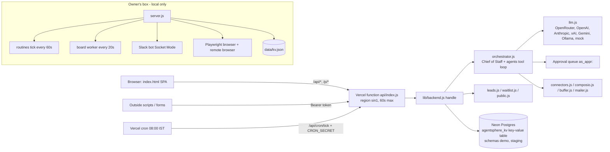

# AIdentify: team handover plan

For the LangGraph and AI/full-stack engineers taking over AIdentify (Agent-as-a-Service).
Repo: `github.com/aidendify/AaaS` (**private, proprietary, all rights reserved** from v1.6.0). Written 19 Oct 2026 (IST).
Read this first, then `HANDOFF.md`, `CHANGELOG.md`, `docs/STAGING.md`, `docs/HOSTED-AI.md`, `docs/API-LEADS.md`, `SECURITY.md`, `test/e2e/REPORT.md`.
The roadmap in section 5 comes from the GoHighLevel comparison report (`ghl-vs-aidentify.md`, kept on the owner's box at `/workspace/research/`, not in the repo; ask Phanindra for a copy).

> **No secret values are in this document.** Secrets are referred to only by name and location. See section 2 for how they're handed over.

---

## 1. One-page overview

**What it is.** AIdentify is an AI-agent workspace for businesses. You sign up, describe your business, and a **Chief of Staff** assistant sets up a team of agents: lead replies, follow-ups, quote tracking, social posts, research, a CRM agent and a real browser agent. **Anything that sends, posts, publishes, pays or signs in waits for a human approval.** It runs as a web app (and a Slack bot for the owner).

**Two ways we sell it (inspired by GoHighLevel, where Phanindra ran a white-label agency):**

| Path | Who buys | What they get | Ready after |
|---|---|---|---|
| **A. Direct** | Individual business owners | Their own workspace: CRM, tracking, agents, follow-ups | v1.11 (billing) + v2.0 (CRM core) + v2.2 (tracking) |
| **B. White-label** | Agencies | Agency account with client sub-accounts, their own branding/domain, reusable "Playbooks" (our version of GHL snapshots), rebilling with their markup | v2.6 |

- **White-label, not affiliate.** We sell agencies a wholesale plan they rebrand and resell; we are not building an affiliate programme.
- **Ideal customers:** agencies and digital / email-marketing business owners (also real estate as an early vertical).
- **Market:** India first: INR pricing, Razorpay + GST invoices, WhatsApp-first channels, DPDP Act consent.
- **Where we beat GHL:** depth of AI agents (multi-agent Chief of Staff), any AI provider with bring-your-own-key and cost caps, approval-first safety. **Where GHL beats us:** the platform underneath (relational CRM, tenancy, tracking, event workflows, channels, snapshots, rebilling). The roadmap closes that gap.
- **Pricing idea (to validate, + 18% GST):** Solo ₹1,999–2,999/mo, Growth ₹5,999/mo, Agency Starter ₹9,999/mo (5 clients), Agency Pro ₹19,999/mo + ₹999/extra client. AI and messages always metered, never "unlimited".

---

## 2. Access and accounts checklist

Phanindra (owner) grants all of these. **Secrets move only through Vercel team access and a shared password manager (1Password/Bitwarden vault "AIdentify")**, never Slack, email, chat or git.

| # | Account | What it's for | Access needed | Status |
|---|---|---|---|---|
| 1 | **GitHub org `aidendify`**, repo `AaaS` | Code, releases, CI (GitHub Actions) | Write for engineers, admin for 1 lead | Live |
| 2 | **Vercel team `aidentify`** (Hobby) | Projects: `aidentify-demo` (prod product), `aidentify` (landing, env `AIDENTIFY_SITE=landing`), `aidentify-staging` (staging) | Member on the team | Live. GitHub is **not linked** to Vercel; deploys are CLI only |
| 3 | **Neon** Postgres (ap-southeast-1, Singapore) | Data. Schema `demo` = prod, schema `staging` = staging | Project member | Live |
| 4 | **OpenRouter** | Shared platform AI key, model `deepseek/deepseek-v4-flash` on hosted | Org member or a new team key | Live, in-app $10 soft cap |
| 5 | **Slack workspace "AIDENTIFY"**, bot `agentsfactory` | Owner's Slack bot (Socket Mode) | Workspace member + app collaborator | Runs on the owner's box only |
| 6 | **Composio** | Managed OAuth for ~35 connected apps | Team member | Key exists, Test buttons not verified on a real account |
| 7 | **Razorpay** | Subscriptions + GST invoices (v1.11) | Keys + GSTIN from owner | **Pending** |
| 8 | **Google Cloud OAuth client** | "Sign in with Google" | Project editor | **Not live** (hidden on hosted until `GOOGLE_CLIENT_ID/SECRET` are set) |
| 9 | Buffer, Tavily, Gmail app password, Gumroad | Social posting, web search, mail, product listings | As needed | Local box mostly |

**Where secrets live (names only):**

| Location | Variable names |
|---|---|
| Vercel `aidentify-demo` env (production + preview) | `DATABASE_URL`, `DATABASE_SCHEMA`, `SESSION_SECRET`, `ADMIN_EMAIL`, `ADMIN_PASSWORD`, `CRON_SECRET`, `BRAND_NAME`, `OPENROUTER_API_KEY`, `OPENROUTER_MODEL`, `AI_PROVIDER`, `PLATFORM_AI_BUDGET_USD`, `PLATFORM_AI_DAILY_USD` (+ optional `PLATFORM_AI_STOP_AT`, `PLATFORM_AI_USER_DAILY_CALLS`, `PLATFORM_AI_USER_DAILY_USD`) |
| Vercel `aidentify-staging` env | Same set plus `AI_MOCK`, `APP_URL` (staging uses its own `SESSION_SECRET`, `CRON_SECRET`, admin password and a $2 budget) |
| Vercel `aidentify` (landing) | `AIDENTIFY_SITE`, DB vars for the waitlist |
| Owner's box (chmod 600, not in git) | `/workspace/aaas-run/vercel.env.local` (prod values), `/workspace/aaas-run/staging.env.local` (staging values), `/workspace/aaas-run/vercel-admin.secret` (hosted admin password) |
| Local server `.env` (see `.env.example` for all names) | Slack (`SLACK_BOT_TOKEN`, `SLACK_APP_TOKEN`, `SLACK_SIGNING_SECRET`, `SLACK_OWNER_USER_ID`), `COMPOSIO_API_KEY`, `BUFFER_API_KEY`, `TAVILY_API_KEY`, `GMAIL_USER`/`GMAIL_APP_PASSWORD`, OAuth client IDs/secrets |

**Handover steps:** (1) owner invites engineers to GitHub, Vercel, Neon, OpenRouter, Slack, Composio; (2) owner copies the box `*.env.local` / `.secret` values into the password-manager vault; (3) **rotate** the secrets that were ever on one person's machine (admin passwords, `CRON_SECRET`, OpenRouter key) once the team has access. Note: rotating `SESSION_SECRET` logs everyone out **and makes stored BYOK keys unreadable** (they're encrypted with a key derived from it), so plan that one as a migration, not a casual rotation.

---

## 3. Everything built so far

### 3.1 By release

| Release | Plain language | Key files |
|---|---|---|
| v1.1–v1.3 (before handover window) | Web workspace, Chief of Staff + agents, routines, connected apps, Buffer posting, real browser agent, public share pages, Slack bot, task boards, remote browser, lead finder, one-line installer, Docker; Settings page (16 areas, 6 AI providers, cost cap, approvals, encrypted secrets) | `server.js`, `index.html`, `lib/orchestrator.js`, `lib/llm.js`, `lib/connectors.js`, `lib/slack.js`, `lib/settings*.js` |
| **v1.4.0** security basics | No default passwords (first-run `/setup` with one-time code), weak passwords refused, remote browser 60-min cap + rate limit + audit, owner-only; SECURITY guide; tests | `lib/remote-browser.js`, `lib/authx.js`, `SECURITY.md`, `test/security.test.mjs`, `test/remote-browser.test.mjs` |
| **v1.5.0** Postgres/Neon | Hosted mode requires Postgres (Neon or any); retries, pool, compare-and-swap, locks, migrations; `db:migrate-from-file` / `db:export-to-file`; first automated test suite + CI Postgres | `lib/db.js`, `scripts/db-migrate.mjs`, `test/storage.test.mjs`, `test/flows.test.mjs` |
| **v1.6.0** licence | Proprietary, all rights reserved; contributions by invitation; earlier MIT copies keep MIT for those versions | `LICENSE`, `CONTRIBUTING.md` |
| **v1.7.0** hosted demo | Live demo on Vercel; waitlist (email required, dedupe by email/WhatsApp, CSV export); landing page at aidentify.vercel.app; shared OpenRouter key with in-app $10 soft cap ($9.50 stop, $2/day pool, 60 calls or $0.50 per user/day); bring-your-own AI key at onboarding (validated, AES-256-GCM, last 4 shown, never falls back to our key); Google/email-code login hidden until configured | `api/index.js`, `vercel.json`, `scripts/vercel-build.mjs`, `.vercelignore`, `waitlist.html`, `lib/waitlist.js`, `lib/aikeys.js`, `lib/usage.js`, `docs/HOSTED-AI.md` |
| **v1.7.1** staging tooling | Mock AI provider (`AI_PROVIDER=mock` + `AI_MOCK=on`, free, never falls back to paid AI); one JSON log line per request (route, status, ms, AI calls, cost, hashed user id); admin `/api/admin/metrics` | `lib/llm.js`, `lib/obs.js`, `docs/STAGING.md`, `test/mock-obs.test.mjs` |
| **v1.8.0** e2e suite | `npm run e2e` scenario suite (agency owner, lead flow, BYOK, outside script) with REPORT.md; fixed 500 on broken JSON; account delete now removes public-link tokens | `test/e2e/run.mjs`, `test/e2e/REPORT.md`, `test/delete-cleanup.test.mjs` |
| **v1.9.0** fixes + speed | Functions moved to Singapore `sin1` next to Neon (big speed-up); batched DB reads; `/api/kv` reads only the caller's rows; AI time limits with clean `504 ai_timeout`, public pages wait max 8 s; **draft approvals** for accounts with no connected app; business profile at signup used in every AI call; one-off routines (`run_at`, `repeat_every_days`); daily Vercel cron 08:00 IST → `/api/cron/tick`; account delete removes rows and anonymises spend log | `lib/backend.js`, `lib/orchestrator.js`, `vercel.json`, `test/v190.test.mjs`, `test/e2e/bench.mjs` |
| **v1.10.0** leads API (**held, ready**) | `POST/GET /api/leads`, `GET/PATCH/DELETE /api/leads/:id`; dedupe on email/phone (409 or `upsert`); optional follow-up (`in_days` / `run_at`) that drafts for approval, never sends; per-customer lock; staging e2e 5/5 | `lib/leads.js`, `docs/API-LEADS.md`, `test/leads.test.mjs`, e2e scenario e |

**Git state:** `main` = `a9aff2e` (v1.9.0, GitHub Releases v1.7.0–v1.9.0 published). Branch `leads-v1.10.0` = `e3febb0` (+ this handover doc), **local on the owner's box, not pushed**. First team task: push it and release v1.10.0 with owner OK.

**Before → after speed (staging, server-side p50):** AI request (mock) 1.1 s → 0.014 s; account delete 4.2 s → 0.07 s; workspace load 0.9 s → 0.009 s; real-AI agent chat ~20 s → ~6 s.

### 3.2 Live URLs

| URL | What |
|---|---|
| https://aidentify.vercel.app | Landing page + waitlist (project `aidentify`) |
| https://aidentify-demo.vercel.app | Live product demo (project `aidentify-demo`, schema `demo`). Health: `/api/health`. Waitlist `/waitlist`, `/early-access` |
| https://aidentify-staging.vercel.app | Staging (project `aidentify-staging`, schema `staging`, $2 budget, mock AI by default) |

### 3.3 Current architecture



**Data model today:** one key-value table `agentsphere_kv(k, v, ver, …)` with per-user keys: `as_data:<email>` (whole workspace JSON incl. CRM, 2 MB cap), `as_rt:` routines, `as_appr:` approvals, `as_mem:` memory, `as_conn:` encrypted connector tokens, `as_aikey:` BYOK, `as_board:`/`as_groups:`, `as_pub:` public-page events, `as_sys_aipool` spend log. CRM entities (lead, customer, deal with one fixed 8-stage pipeline, task, activity) are defined client-side in `index.html` (`CRM_BP`).

**Local-only pieces that must move to a server (v2.1):** the Slack bot, board worker, every-minute routine ticks, and the Playwright browser / remote browser run only on the owner's box (`server.js`, supervised by `/workspace/aaas-run/supervise.sh`). The box's own server still uses `data/kv.json`. Vercel can't run these.

---

## 4. Known issues and deferred work

| # | Issue | Severity | Notes |
|---|---|---|---|
| 1 | Whole workspace is one JSON blob; CRM not relational; no tenancy (agency → clients) | **High** (blocks roadmap) | v2.0 |
| 2 | Vercel **Hobby is non-commercial** under Vercel's terms | **High before paid launch** | Move to Vercel Pro or a VPS/Fly-style host before taking money (verify current terms) |
| 3 | No billing: Razorpay webhook verifier exists (`lib/billing.js`), no routes | High | v1.11, needs keys + GSTIN |
| 4 | Hosted scheduler is once a day; every-minute needs an outside pinger (cron-job.org) or a worker | Medium-High | v2.1; interim pinger documented in `docs/STAGING.md` |
| 5 | Slack bot, board worker, browser only on owner's box | Medium-High | Single point of failure; v2.1 |
| 6 | Rate limits, login throttles and metrics are per server instance (in memory) | Medium | Reset on cold start; move to Postgres/Upstash (F12) |
| 7 | Real-AI chat still up to ~10–30 s; no streaming/async | Medium | Deferred from F5 |
| 8 | Staff `/api/kv` still reads every row | Medium | Only staff, but grows with customers |
| 9 | Approving actions on key-only apps (e.g. Trello) becomes a draft; direct Trello actions not built | Low-Med | Deferred from F6 |
| 10 | GitHub not linked to Vercel; deploys are CLI only from the owner's box | Medium | Link via a Vercel Login Connection; add preview deploys per PR |
| 11 | Google / email-code login not configured on hosted | Medium | Needs OAuth client + SMTP |
| 12 | No API keys for scripts (login token only), no CORS, no outbound webhooks | Medium | v2.3 |
| 13 | Old placeholder/tombstone rows still in `demo` schema; possible orphan `as_tok` rows | Low | One-off cleanup, with owner OK |
| 14 | Out-of-credit / revoked BYOK only tested with mock (F13) | Low | Make a $0-limit OpenRouter test key |
| 15 | Some Settings Test buttons never tried on real accounts (Gumroad, Buffer, Composio, Gmail, OpenAI, Google, Ollama) | Low | Verify during v2.x |
| 16 | No Android/Windows builds; Docker image has no Chrome | Low | Not a priority |
| 17 | `SESSION_SECRET` also derives the BYOK encryption key | Low (ops risk) | Separate into its own key with re-encryption in v2.0 |

---

## 5. Roadmap to build (v1.10 → v2.8)

Effort: **S** ≤ 3 days, **M** 1–2 weeks, **L** 3–5 weeks (for one engineer; parallelise where noted). Owners: **LG** = LangGraph engineers (agents, orchestrator, workflows, self-learning); **FS** = AI/full-stack engineers (data model, tenancy, tracking, billing, white-label).

**Order:** v1.10 → v1.11 → v2.0 → v2.1 → v2.2 → v2.3 → {v2.4, v2.5} → v2.6 → v2.7 → v2.8. Path A can sell after v1.11 + v2.0 + v2.2; path B after v2.6.

| Release | Goal | Scope | Acceptance criteria | Effort | Depends on | Owner |
|---|---|---|---|---|---|---|
| **v1.10.0** Leads API | Ship what's built | Push `leads-v1.10.0`, release, deploy demo | `npm test` green; e2e a–e pass on staging; demo `/api/health` ok; one live lead create+delete | S (≤1 day) | — | FS |
| **v1.11.0** Billing | Take money in India | Razorpay Subscriptions + plans; wire `lib/billing.js` to a webhook route; GST tax invoices (GSTIN, SAC code, CGST/SGST vs IGST by state, verify with CA); invoice PDFs; dunning; plan limits enforced server-side | Test-mode subscription end to end; webhook signature + idempotency tested; invoice shows correct GST split; failed payment downgrades plan; **every charge path approval-first / user-initiated** | M | Razorpay keys + GSTIN; Vercel Pro/host decision | FS |
| **v2.0.0** Relational core + tenancy | CRM becomes the system of record | Tables: `orgs` (agency/business, parent), `memberships` (roles), `contacts`, `companies`, `custom_field_defs` + `custom jsonb`, `tags`, `pipelines`/`stages`/`opportunities`, `tasks(due_at)`, append-only `events` timeline; agents/routines/approvals/memory to tables; Postgres Row-Level Security on `org_id`; reversible migration from the blob with a dual-read period; `/api/kv` kept for the UI; `/api/leads` becomes a layer over `contacts`; CRM agent gets typed tools (`crm_search`, `crm_update`, `timeline`); consent fields from day one (DPDP) | Migration script round-trips staging data with zero diffs; RLS test proves org A can't read org B; old UI works unchanged; leads e2e still passes; p95 workspace load < 300 ms | L | v1.10 | FS (schema, migration, RLS) + LG (typed CRM tools) |
| **v2.1.0** Queue + always-on worker | Minute-level jobs, retries, no local box | `jobs` table claimed with `FOR UPDATE SKIP LOCKED`, idempotency keys, backoff, dead-letter view; small always-on server in India (Bangalore/Mumbai VPS ~$5–12/mo, verify) runs worker, Slack bot, Playwright browser; Upstash QStash optional | Owner's box can be switched off and Slack bot, routines, board worker keep working; a follow-up due in 2 min fires within 1 min; killed worker mid-job → job retried once, not duplicated | M | v2.0 | FS (infra) + LG (agent job runner) |
| **v2.2.0** Tracking + consent | Every click/visit builds the contact's history | Short/trigger links with per-contact token (bot filtering, reuse `/p/v` logic); site snippet `t.js` ≤ 5 KB (page views, UTM, referrer, gclid/fbclid, form capture, identify); first/last-touch attribution; email open pixel (approximate) + click rewriting; consent banner, consent records, withdrawal, erasure/export endpoints, retention; contact timeline UI | Click on a tracked link appears on the right contact's timeline within 5 s; UTM stored; no identifying cookie before consent where required; erasure removes contact + events; snippet ≤ 5 KB gz | M | v2.0, v2.1 | FS |
| **v2.3.0** Workflow engine v1 | Workflows that react to CRM events | Triggers (contact created/updated, tag, form, link click, page visit, stage change, won/lost, reply, inbound webhook, schedule, task due); steps (if/else, wait, wait-until-event with timeout, actions: tag, field, stage, task, AI draft, email, WhatsApp template, webhook, call agent, notify owner); **per-action policy: always ask / auto within limits / auto**; JSON graph run by the queue with ordering + idempotency; form-based editor + "describe it in words" generator; API keys per org, outbound webhooks, CORS allow-list | 10 sample workflows run on staging; replaying an event doesn't double-run; a "send" step defaults to approval; wait-until-event resumes after a click; generator turns a plain sentence into a valid workflow | L | v2.1, v2.2 | **LG** (engine on LangGraph, see 5.1) + FS (triggers, API keys, webhooks) |
| **v2.4.0** Owned channels | Reach contacts directly | 2.4a campaign email via provider (SES Mumbai/Postmark-class), per-org SPF/DKIM/DMARC check, unsubscribe, suppression, warm-up; 2.4b WhatsApp Cloud API via Embedded Signup (client pays Meta), templates, 24 h inbox, opt-in; 2.4c SMS via DLT-ready provider, BYO-DLT (last); unified inbox with AI suggested replies (approval-first) | Domain check UI passes on a test domain; one-click unsubscribe honoured; WhatsApp template sent on staging test number; no message leaves without the configured policy | L (split into 3×M) | v2.3 | FS (channels) + LG (inbox reply agent) |
| **v2.5.0** Playbooks (snapshots) | Agencies package and resell setups | Export agents + KB/prompts, workflows, pipelines, fields, tags, forms, templates, routines as a versioned JSON bundle (never contacts or secrets); import with dry-run diff, skip/override; share links; protected bundles; push v2 updates to installs; 5 starter playbooks (lead intake, email nurture, webinar follow-up, reviews, re-engagement) | Export → import into fresh org reproduces config; secret scan on bundle finds nothing; update v1→v2 applies diff without losing local edits | M | v2.0, v2.3 | LG (agent/workflow bundles) + FS (format, import) |
| **v2.6.0** Agency white-label | Path B launch | Agency dashboard (create/suspend clients, load playbooks, usage + margin, audited impersonation); per-agency branding (logo, colours, name, emails, login page); custom domains (Vercel Domains API or Caddy on-demand TLS); per-org usage ledger, wallet top-ups, agency markup per service, GST on both legs (Razorpay Route, verify KYC); agency-level BYOK | Agency creates a client, installs a playbook, client logs in on agency domain with agency branding and never sees "AIdentify"; markup shows on client invoice; impersonation logged | L | v2.0, v1.11, v2.5 | FS |
| **v2.7.0** Chief of Staff self-learning | CoS suggests new workflows from results | Mine `events` + outcomes per workflow/step/template/channel; weekly Opportunities digest (Slack/email/WhatsApp); proposals are ready-to-install workflow/playbook diffs, installed only on approval; A/B of follow-up sequences (split by contact hash, minimum sample, stop rule, promote only with approval); cross-tenant learning only from anonymised opt-in aggregates | Digest on staging data names at least one real pattern with numbers; installing a suggestion needs one approval; A/B stops at the stop rule; no tenant data crosses orgs | M then ongoing | v2.2, v2.3 | **LG** |
| **v2.8.0+** | Extras | Booking calendar + Google Calendar sync; form/survey builder; review requests (extend `/p/r`); public playbook marketplace (we take %); developer API keys/OAuth apps; branded PWA | Per feature | M each | v2.6 | Mixed |

**Don't build (integrate instead):** funnel/website builder, native mobile apps, voice AI, communities. Use the snippet on WordPress/Webflow, Calendly/Google Calendar, Buffer.

### 5.1 Should we port the orchestrator to LangGraph?

Today `lib/orchestrator.js` is a hand-written Node tool loop (Chief of Staff delegates with `ask_agent`, max 2 hops; `propose_action` puts actions in the approval queue). It works, is tested, and is small.

| | Port everything now | Incremental (recommended) |
|---|---|---|
| Pros | One framework; LangGraph's graph, checkpointing, human-in-the-loop `interrupt()` fit approvals | Ships value sooner; keeps tested behaviour; LangGraph used where it clearly helps |
| Cons | Rewrite risk on a working, tested core; JS app vs Python LangGraph split (LangGraph.js exists but is less mature); breaks e2e suite until done | Two agent runtimes for a while |

**Recommendation:**
1. **Keep the current chat orchestrator** for now. Freeze its contract: the tool names, the approval queue format and the rule that sends/posts/pays only happen after approval.
2. **Build the v2.3 workflow engine on LangGraph** (LangGraph.js to stay in one Node codebase, or a Python service behind an internal HTTP API if the team is stronger in Python). Use the **Postgres checkpointer on Neon** so long waits ("wait 3 days", "wait until click") survive restarts, and use `interrupt()` for approvals that feed the **same** approval queue the UI already shows.
3. **Build v2.7 Chief of Staff self-learning on LangGraph** as a scheduled graph: read `events` → analyse → draft proposal → interrupt for approval → install.
4. Once the engine is proven, decide whether to move chat agents onto it. Port only if the e2e suite passes unchanged.
5. **Non-negotiable in any port:** approval-first semantics, BYOK never falling back to the shared key, platform cost caps enforced per call, per-org isolation, mock AI provider support for free testing.

### 5.2 Before charging anyone
Vercel **Hobby is for non-commercial use only**. Before the first paid customer (v1.11 going live), move `aidentify-demo` to **Vercel Pro** (also unlocks more cron runs and longer functions) or to the v2.1 India VPS / a Fly-style host. Verify Vercel's current terms at that time.

---

## 6. Engineering rules (non-negotiable)

1. **Never commit secrets.** Use Vercel env vars and the password-manager vault. `.vercelignore` blocks `.env*`; keep it that way. Run secret scanning before every push.
2. **Approval-first** for anything that sends, posts, publishes, pays or signs in. New features default to "always ask". Auto-send only via an explicit per-action policy the customer turned on.
3. **No destructive git without the owner's OK:** no force-push, history rewrite, `reset --hard` on shared branches, or deleting branches/tags/releases. Ask Phanindra first.
4. **One step = one release:** its own branch, version bump in `package.json`, plain-language `CHANGELOG.md` entry, GitHub Release with notes.
5. **Update `HANDOFF.md` every session:** what shipped, what's in progress, what broke and what was fixed.
6. **Staging before prod, always.** Deploy to `aidentify-staging`, run `npm test` + the e2e suite, then prod. Never deploy to prod from a folder linked to staging or vice versa.
7. **Mock AI first, real AI once:** iterate on mock, finish with one real-AI run, keep real spend per release under ~$1.
8. **Privacy:** logs never contain emails, IPs, prompts or answers (hashed uid only). Test accounts are `e2e-…@example.com` and are deleted after every run.
9. **No touching prod data** (schema `demo`) for cleanup or migrations without owner OK and a backup (`npm run db:export-to-file`).

---

## 7. Stress-testing playbook (how we did it, and what's next)

### 7.1 Setup
- **Staging** = Vercel project `aidentify-staging` + Neon schema `staging` + its own `SESSION_SECRET`, `CRON_SECRET`, admin password, and `PLATFORM_AI_BUDGET_USD=2`. Details in `docs/STAGING.md`.
- **Mock AI** on staging by default: `AI_PROVIDER=mock` and `AI_MOCK=on` (both required). Free, fixed answers (`[mock <hash>] …`), realistic fake token costs so caps and logs still work. Drive tools with `[[mock:tool_name {"json":"input"}]]`. BYOK keys containing `nocredit` → 402, `badkey` → 401. `/api/health` shows `aiMock: true`.
- **Real AI run:** set `AI_PROVIDER=openrouter` and `AI_MOCK=off` on staging, redeploy, run once, switch back.

### 7.2 Running the tests
```bash
npm ci
npm test                                   # unit/security/storage/leads tests (node --test test/*.test.mjs), local stand-ins, free
E2E_CRON_SECRET=… E2E_ADMIN_EMAIL=… E2E_ADMIN_PASSWORD=… \
  npm run e2e -- --base https://aidentify-staging.vercel.app [--only a,b] [--label "what this run is"]
node test/e2e/bench.mjs                    # latency bench
```
Results append to `test/e2e/REPORT.md` (pass/fail per check, time, AI calls, shared-key cost).

**Box-only helper scripts (not in the repo), and what to do instead:**
- `/workspace/aaas-run/stg-sync.sh` copied the worktree (minus `.git`, `.vercel`, `node_modules`, `.env*`, `public`) into a folder linked to `aidentify-staging`, then `npx vercel deploy --prod --yes --scope aidentify` ran from there. **Team equivalent:** a separate checkout linked with `vercel link --project aidentify-staging --scope aidentify`, or better, link GitHub to Vercel and deploy staging from a `staging` branch / CI job.
- `/workspace/aaas-run/e2e-staging.sh` loaded `staging.env.local` with a small parser (not `source`, because the DB URL contains `&`) into the `E2E_*` env vars and ran the suite. **Team equivalent:** a CI job with GitHub Actions secrets, or a local `.env.staging` loaded by `dotenv` (gitignored).

### 7.3 Scenarios (all pass on v1.10.0 staging)

| | Scenario | What it proves |
|---|---|---|
| a | Agency owner: signup with business profile, 10 drafts (posts/replies), approve some | Profile reaches AI; drafts land in approval queue; nothing sends without approval; prompt injection ("email/post everywhere") does nothing |
| b | Lead flow: public quote form `/p/*` → CRM → qualify → follow-up routine → `/api/cron/tick` | End-to-end lead capture and scheduled follow-up |
| c | Bring your own key: valid, wrong, no-credit keys | Clean errors; **never falls back to shared key**; spend unchanged |
| d | Outside script: login token, `/api/ai`, `/api/workplace/chat`, tampered/expired/missing tokens | API works headless; bad tokens get 401 |
| e | Single-lead API: add, dedupe (409/upsert), list, patch, delete, follow-up | Leads API correct; 8 concurrent adds lose nothing |

### 7.4 Phase 2 "break it" tests (not done yet: do these next)

| Test | How | Pass bar |
|---|---|---|
| Load | 10 → 50 → 200 concurrent users doing chat + `/api/kv` + leads (k6 or autocannon), on mock AI first | p95 and error rate recorded per step; find the break point (Vercel 60 s, Neon connections, pool) |
| Budget exhaustion | One user burns 60 calls; many users rush the $2/day pool; total cap at 95% | Exactly the right call is refused with the friendly "add your own key" message; no overshoot beyond one call |
| Prompt injection | Inject via chat, lead notes, form fields, KB docs, web pages the browser reads | Zero actions without approval; no data from another account |
| Bad input | Huge prompts, junk/huge JSON, unicode, expired tokens, signup spam, waitlist spam | 400/401/413/429, never 500; throttles hold across instances (F12) |
| Provider outage | Mock slow (45 s+) / 5xx / 429 from AI provider | Clean `504 ai_timeout` or retry/fallback model; no hung requests |
| Database failure | Kill connections mid-request, Neon cold start | Retries work; no partial writes |
| Concurrent saves | Two tabs `PUT /api/kv` at once; lead API + tab save together | Revision check merges or rejects; nothing silently lost |
| Cron overlap | Many `/api/cron/tick` calls at once | Each routine runs once (10-min lock) |

### 7.5 Metrics to record each run
From `/api/admin/metrics?minutes=60` and REPORT.md: requests, error rate, p50/p95/max per route, AI calls and cost per scenario and in total, shared-pool spend, cold starts, Neon query count per request, and before → after numbers for any fix.

### 7.6 Release gate checklist
- [ ] `npm test` green locally and in CI
- [ ] Deployed to staging; `/api/health` ok
- [ ] e2e a–e pass on mock AI
- [ ] One real-AI e2e run passes; spend noted (target < $1)
- [ ] No new 500s in metrics; p95 not worse than last release (or explained)
- [ ] Approval-first and BYOK-no-fallback checks pass
- [ ] Secret scan clean; no `.env*` in the diff
- [ ] Test accounts cleaned up
- [ ] `CHANGELOG.md`, `HANDOFF.md`, docs updated; version bumped
- [ ] **Owner OK** to merge, release and deploy prod; then prod `/api/health` + one smoke test with a throwaway account deleted afterwards

---

## 8. First two weeks

| When | FS engineers | LangGraph engineers |
|---|---|---|
| **Days 1–2** | Get all access (section 2); secrets into vault; clone, `npm ci`, `npm test`; run e2e on staging; link GitHub to Vercel; owner pushes `leads-v1.10.0` | Read `lib/orchestrator.js`, `lib/llm.js`, approval flow; run the app locally on mock AI; walk scenarios a and d by hand |
| **Days 3–4** | **Release v1.10.0** via the release gate | Write the frozen "agent contract" doc (tools, approval queue format, cost hooks) |
| **Week 1 end** | Phase 2 break-it tests (load, budget, bad input, concurrent saves); add results + findings to REPORT.md | Phase 2 prompt-injection + provider-outage tests; spike LangGraph.js vs Python service with a Neon Postgres checkpointer and `interrupt()` feeding our approval queue |
| **Week 2** | Fix top Phase 2 findings (likely F12 shared throttles); draft v2.0 schema + RLS + migration plan for review; decide host for paid launch (Vercel Pro vs India VPS); start v1.11 billing as soon as Razorpay keys + GSTIN arrive | Prototype one workflow on LangGraph ("new lead → wait 3 days → AI draft follow-up → approval") against staging; design doc for v2.3 engine and v2.7 self-learning |
| **End of week 2 review with Phanindra** | v1.10 live, Phase 2 report, v2.0 design, hosting decision | LangGraph decision with evidence, v2.3 design |

**Owner inputs needed early:** Razorpay keys + GSTIN, decision on Vercel Pro vs VPS, Google OAuth client (if Google login wanted), 10 agency conversations to validate pricing.
